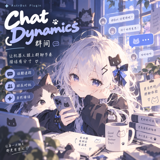
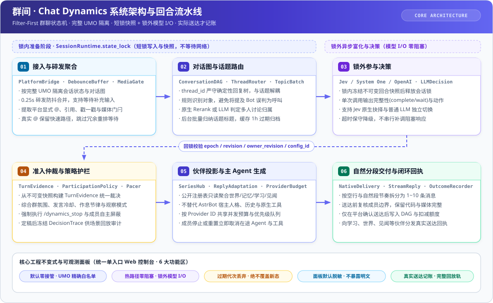
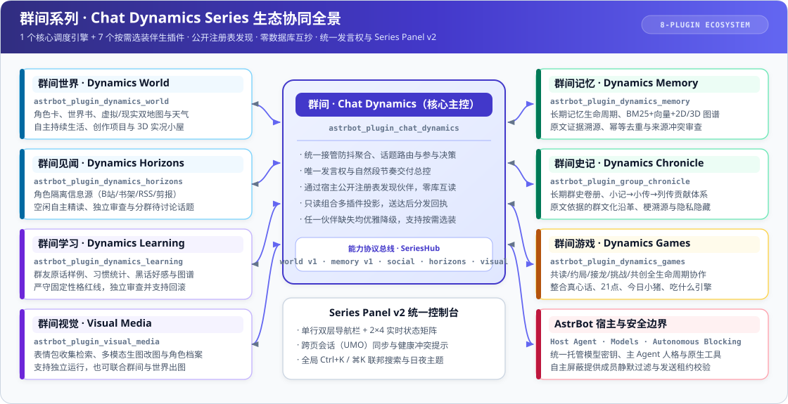

# 群间 · Chat Dynamics

**AstrBot 群间系列核心对话调度引擎：让机器人读懂群聊节奏，接话有分寸。**

[核心架构](#核心架构) · [系列生态](#群间系列生态) · [模型配置](#模型与路由选择) · [快速开始](#快速开始) · [进阶文档](#进阶文档与许可)

---

## 为什么需要群间

普通群聊机器人通常采用「收到消息即直连 LLM」的单向管道，在活跃群聊中极易出现**打断碎发、抢话刷屏、把旁观提及误当呼叫、多话题串台**等问题。

**群间 · Chat Dynamics** 采用 **Filter-First（过滤优先）** 架构，位于平台消息事件与 AstrBot 主 Agent 之间：它负责**碎发聚合、对话图路由、参与时机决策、伴生能力投影与拟人化分段交付**，而**绝不替代 AstrBot 宿主人格、对话历史、模型服务与原生工具**。

---

## 核心架构

### 1. 六阶段回合流水线

群间在 `main.py` 中注册 AstrBot 生命周期钩子，并将回合准备、锁外富化、准入裁决与投递回执拆分为清晰的无冗余路径（`core/turn_pipeline.py`、`core/native_delivery.py`）：

| 阶段 | 核心模块 | 职责与边界 |
| --- | --- | --- |
| **01 接入与碎发聚合** | `PlatformBridge` `DebounceBuffer` `MediaGate` | 按完整 **UMO** 隔离会话状态与对话图；通过 0.25s 碎发窗口合并连续短句，支持 `pending_input_timeout`（默认 60s）等待补充输入；提取显式 `@`、引用回复、戳一戳与媒体门闩。真实 `@` 保留快速路径，跳过冗余等待。 |
| **02 对话图与话题路由** | `ConversationDAG` `ThreadRouter` `RuleTopicRouter` `TopicBatch` | `node.thread_id` 严格保留平台确定性回复树，不写入启发式猜测边，与语义讨论 `topic_id` 解耦。规则层识别明确对象并区分「提及 Bot」与「呼叫 Bot」；多人讨论归属按消息记录（允许同一成员并行参与不同话题），由后台批量归纳话题标题并在 1 小时无人类发言后自动归档。 |
| **03 锁外决策与富化** | `JevDecision` `LLMDecision` `TurnDecision` | 锁内冻结不可变回合快照后**释放会话锁**，在锁外异步请求决策模型，单次调用联合输出完整性（`complete` / `wait`）、参与意愿、动作倾向与期望长度。超时保守处理，不串行补调阻塞响应。 |
| **04 准入仲裁与护栏** | `TurnEvidence` `ParticipationPolicy` `Pacer` / `DailyRhythm` | 回到会话锁内复核版本与代次，从不可变快照构建 `TurnEvidence`，综合群氛围（`VibeAnalyzer`）、冷却/额度、每日作息、观察模式、成员停止（`/dynamics_stop`）与自主屏蔽边界做出最终准入裁决，并冻结可回放的 `DecisionTrace`。 |
| **05 伙伴投影与主 Agent** | `SeriesHub` `ReplyAdaptation` `PersonaEngine` `ProviderBudget` | 通过宿主公开注册表只读聚合已安装的伙伴上下文（世界、记忆、学习、见闻、视觉），经按 Provider ID 共享的 `ProviderBudget` 并发队列（默认并发 4，回复高优先级）进入 **AstrBot 主 Agent** 生成正文与工具调用。 |
| **06 自然交付与闭环回执** | `NativeDelivery` `StreamReply` `OutcomeRecorder` | 按空行与自然段节奏拆分为 `1~10` 条消息（保留代码、公式、列表与媒体链完整），送达前复核成员边界；**仅在平台确认实际送达后**写入 DAG、扣减开口额度，并将送达回执分发给学习、世界、见闻等伙伴。 |

### 2. 并发与一致性设计

- **短锁快照 + 锁外模型 I/O**：`SessionRuntime.state_lock` 仅包裹本地读写与快照冻结，所有 Embedding、Rerank、决策与回复模型调用均在锁外执行，保证高活跃群聊下消息写入零阻塞。
- **四元乐观版本护栏**：锁外异步结果回写前严格校验 `epoch`、`revision`、`owner_revision` 与 `config_id`。成员发起 `/dynamics_stop`、会话重置、配置变更或插件热重载时，在途 Agent 与工具子任务立即取消，过期结果直接丢弃。
- **真实送达记账原则**：严格区分 `generated`、`submitted` 与 `delivered`。取消或发送失败只提交已实际送达的片段；观察模式仅记录决策轨迹，不发送插件回复。

### 3. 模型与路由选择

参与决策与讨论归属可独立切换，原有模型选择互不覆盖；API 地址与密钥统一托管于 AstrBot「模型服务」：

| 环节 | 配置项与模式 | 行为与降级边界 |
| --- | --- | --- |
| **参与决策（何时开口）** | `jev`（默认）：Jev / System One / OpenAI Decisions `llm`：普通聊天模型 | 判断 `complete/wait`、动作、状态与回复长度；LLM 决策默认超时 6s，留空沿用回复模型。 |
| **对象与讨论归属** | `rerank`（默认）：规则 + AstrBot 原生 Rerank `llm`：普通聊天模型辅助判断 | 显式 `@` 与引用优先级最高，不被模型覆盖；低分新发言保留种子，获后续支持再成正式话题。 |
| **话题标题归纳** | 独立聊天模型（`topic_reranker_provider`） | 按 `topic_batch_interval`（默认 30s）后台批量命名，只归纳标题、不改写消息归属。 |
| **正式回复生成** | 回复模型（经 AstrBot 主 Agent） | 完整保留宿主人格、长期历史与所有已授权原生工具。 |

---

## 群间系列生态

基础聊天只需安装 **群间 · Chat Dynamics** 即可运行；其余 7 个伴生插件按需选装。所有插件通过宿主公开注册表发现彼此，**不互相导入源码、不直接读写对方 SQLite 数据库**，并统一接入 **Series Panel v2**（单行双层导航栏、2×4 实时状态矩阵与全局 `Ctrl+K` 搜索）：

| 插件 | 仓库与标识 | 核心定位 |
| --- | --- | --- |
| **群间 · Chat Dynamics**（当前） | [`astrbot_plugin_chat_dynamics`](https://github.com/ysyhlly/astrbot_plugin_chat_dynamics) | 核心对话调度层：碎发聚合、话题路由、参与决策、节奏交付与能力总线 |
| **群间世界 · Dynamics World** | [`astrbot_plugin_dynamics_world`](https://github.com/ysyhlly/astrbot_plugin_dynamics_world) | 角色卡、世界书、虚拟/现实双地图与天气、持续生活、创作项目与 3D 实况小屋 |
| **群间记忆 · Dynamics Memory** | [`astrbot_plugin_dynamics_memory`](https://github.com/ysyhlly/astrbot_plugin_dynamics_memory) | 独立长期记忆库、BM25+向量+2D/3D 图谱混合召回、原文证据与来源冲突审查 |
| **群间学习 · Dynamics Learning** | [`astrbot_plugin_dynamics_learning`](https://github.com/ysyhlly/astrbot_plugin_dynamics_learning) | 固定性格红线下的三层成员资料、黑话好感、互动图谱与可回滚审查学习 |
| **群间见闻 · Dynamics Horizons** | [`astrbot_plugin_dynamics_horizons`](https://github.com/ysyhlly/astrbot_plugin_dynamics_horizons) | 角色隔离的外部信息源与连载书架、空闲自主精读、独立审查与分群待讨论话题 |
| **群间游戏 · Dynamics Games** | [`astrbot_plugin_dynamics_games`](https://github.com/ysyhlly/astrbot_plugin_dynamics_games) | 共读/约局/接龙/挑战/共创全流程协作，整合真心话、21点、今日小猪与吃什么 |
| **群间史记 · Dynamics Chronicle** | [`astrbot_plugin_group_chronicle`](https://github.com/ysyhlly/astrbot_plugin_group_chronicle) | 原文依据的长期群史卷册、小记/小传/列传人物档案与群梗文化沿革 |
| **群间视觉 · Visual Media** | [`astrbot_plugin_visual_media`](https://github.com/ysyhlly/astrbot_plugin_visual_media) | 表情收集检索、多模态生图改图、角色视觉档案与媒体偏好策略（可独立运行） |

---

## 快速开始

1. **安装插件**：在 AstrBot 插件市场安装本仓库，或上传 [Release](https://github.com/ysyhlly/astrbot_plugin_chat_dynamics/releases/latest) 安装包（要求 AstrBot `>=4.29.4,<5`）。
2. **配置模型**：在 AstrBot「模型服务」中准备好聊天模型；若使用 `jev` 决策模式或原生 `rerank` 归属模式，同步添加对应服务。
3. **四步引导启用**：打开插件唯一的 **「群间 · Chat Dynamics」** Web 页面，首次未配置生效群时自动进入 **快速引导**——选择生效群、验证模型连通性、选定场景预设并保存。

> 默认不接管任何群聊；控制台面板默认隐藏消息正文，保护群聊隐私。

### 工作台与常用命令

统一管理页内置 **控制台、快速引导、参数配置、决策模型、记忆小本、场景回放** 六大功能区：

- `/dynamics`（管理员）：查看并控制当前群的参与状态、冷却与会话重置。
- `/dynamics_stop`（任意成员）：立即取消当前成员在途的生成与工具调用。

---

## 进阶文档与许可

- [发布说明与验证边界](RELEASE_NOTES.md) · [更新日志](CHANGELOG.md)
- [回合流水线与状态提交](docs/turn-pipeline.md) · [对话对象与多人话题归属](docs/rule-topic-routing.md)
- [插件联动与接口边界](docs/integrations.md) · [群间世界原生协议](docs/dynamics-world.md) · [OpenAI Decisions 接入](docs/openai-decisions.md)
- 交流与反馈：项目反馈群兼聊天群 QQ `203363132`
- 本项目基于 [MIT License](LICENSE) 开源。
