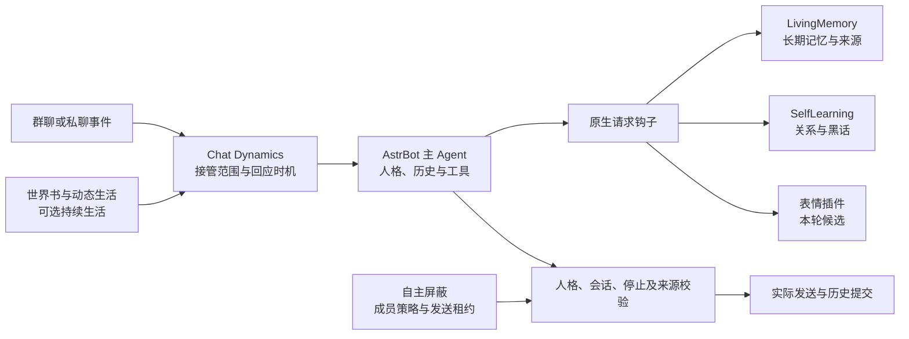

# 插件联动与设置归属

v1.16.0 面向 AstrBot 4.29.4–4.x。Chat Dynamics 负责接话判断、短期对话关系、请求所有权和发送；人格、长期资料及各伙伴的数据仍由原插件维护。基础聊天可以只安装 Chat Dynamics 并配置宿主模型，伙伴按所需功能选装。

## 哪些设置放在哪里

| 负责方 | 配置入口与职责 | 缺失时的行为 |
| --- | --- | --- |
| AstrBot 模型服务 | 决策、聊天、Embedding、Rerank 的地址、密钥和模型；Chat Dynamics 只选择 ID | 所选服务不可用时显示诊断，不切换到未知服务 |
| Chat Dynamics | 群接管与私聊开关、回应门槛、消息合并、话题归属、回复节奏、面板隐私 | 是主插件的配置，不代写伙伴设置 |
| 世界书 | 角色卡与人格绑定 | 持续生活的角色资料不可用；基础聊天仍可使用宿主人格 |
| 动态生活 | 生活状态、叙事模式、人格和会话范围 | 生活状态与事件推进不可用，不编造其返回值 |
| LivingMemory | 长期记忆、召回模型、存储和原文来源 | 原生 Hook 是否可用与持续生活证据 API 是否可用分开判断 |
| SelfLearning | 关系规则、学习、黑话和社交状态 | 可选增强缺失；不代替长期记忆或接话判断 |
| 用户画像 | 画像采集和成员资料 | 当前成员的画像增强缺失 |
| 表情包小偷 | 候选、自动发送、素材和作用域 | 缺少扩展时不启用本轮联合表情路径；文字回复独立保留 |
| 自主屏蔽 | 成员 silence/shield、过滤与发送边界 | 开启 `autonomous_blocking_required` 后，服务未就绪会阻止角色回复 |
| Memory Guard | 独立归还 glibc 已空闲页 | 可选运行维护，与角色记忆和模型选择无关 |

设置页的“接口可用”仅表示本次发现了该接口，不等于所有会话已启用，也不是对每项业务数据的健康检查。“需兼容接口”表示伙伴已安装，但缺少持续生活或联合回复所用的扩展；正常原生 Hook 可以独立工作。刷新联动状态只读，不保存设置或发起 LLM、记忆检索、事件写入。

## 开启持续生活

1. 在世界书和动态生活中设置角色、人格与叙事范围。
2. 在 Chat Dynamics 打开持续生活，选择全部群或完整 UMO 范围。此范围独立于普通群接管范围，私聊也有独立身份。
3. 按需打开主动联系，并核对主动联系的会话白名单。允许推进生活不等于强制发送消息。
4. 在联动卡片确认世界书与动态生活的扩展接口可用；若需要来源可核对的记忆、社交或画像，安装对应兼容接口。

源数据权限与归属由服务端重新校验。昵称、同群、相似话题、亲近度或用户提供的 ID 都不授予跨成员、跨会话的资料读取权限。

## 接口边界

| 能力 | 接口/约定 | 所有者 |
| --- | --- | --- |
| 角色资料 | `get_character_context` | 世界书 |
| 生活状态 | `get_snapshot`、`ingest_events`、`get_intent` | 动态生活 |
| 证据视图 | `get_evidence_view`、`ingest_events`，含作用域和来源复核 | LivingMemory |
| 社交上下文 | `get_social_context` | SelfLearning |
| 成员画像 | `get_profiles` | 用户画像 |
| 表情预取 | `start_joint_reply_prefetch` 返回本请求拥有的检索任务 | 表情插件 |
| 成员策略 | `resolve_context`、`peek_policy`、`policy_snapshot`、`filter_frames` 及发送租约 | 自主屏蔽 |

实现通过宿主公开注册表发现伙伴，不导入对方模块或直接打开其数据库文件。Jev 的当前成员好感度兼容查询通过既有 `db_manager.get_user_affection(group_id, user_id)` 门面进行，只接受账号和群回显匹配的有限数值；过期或已重载伙伴的缓存引用会释放。旧 SelfLearning 管理适配器集中留在 `core/integrations/legacy/`，不参与普通回复的重复注入。记忆原生请求和工具还有独立的身份、回调、来源及版本检查：发现接口不绕过这些检查，Beta 自主回忆工具也不会因此被当作已支持的标准工具。

兼容补丁采用命名的 v1 请求标记承接现有 AstrBot Hook。它们属于程序内部的请求能力，不是聊天中可设置的参数；不得从用户文本构造。独立事件副本上的表情检索禁止发送，采用候选前再次检查作用域。

每次校验都重新解析当前伙伴实例。停用、卸载和同名重载立即影响结果；资料读取可按请求和修订复用，伙伴身份不使用时间缓存。旧实例产生的晚到结果不得写回新实例或发送。

## 升级与兼容包

1. 先备份相关插件源码、配置、SQLite 和索引，并保留回滚；当前运行数据不包含在发布包内。
2. 安装 Chat Dynamics 新版，保留已选模型、接管范围与原有提示词。
3. 普通聊天无需一次性安装全部伙伴。需要扩展时，根据兼容包中的基准提交和文件哈希核对伙伴版本；不能把融合版本号视为上游任意同名版本。
4. 兼容补丁应先离线检查，再对单个目标插件应用和热重载。补丁不自动迁移聊天、清空队列、替换密钥、修改全局模型或重载全部插件。
5. 开启强制屏蔽依赖后，不可通过移除校验或“去掉记忆重试”恢复发送。先修复服务，或由管理员明确关闭此配置后再卸载伙伴。

升级校验至少包含：当前版本和激活状态、原配置保留、来源权限、停用/重载期间的取消、实际发送回执和原有消息不丢失。测试提供商的通过记录与真实 QQ/LLM 结果分别标注。
